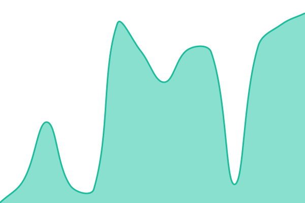
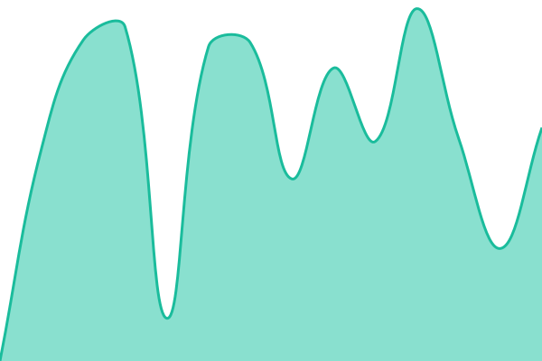
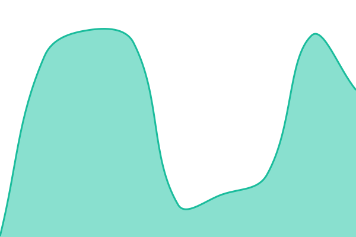

#  [LezWatch.TV](https://lezwatchtv.com)

This repository contains the open-source uptime monitor and status page for [LezWatch.TV (and related repositories)](https://lezwatchtv.com), powered by [Upptime](https://github.com/upptime/upptime).

<!--start: status pages-->
<!-- This summary is generated by Upptime (https://github.com/upptime/upptime) -->
<!-- Do not edit this manually, your changes will be overwritten -->
<!-- prettier-ignore -->
| URL | Status | History | Response Time | Uptime |
| --- | ------ | ------- | ------------- | ------ |
|  [LezWatch.TV](https://lezwatchtv.com) | 🟥 Down | [lez-watch-tv.yml](https://github.com/LezWatch/upptime/commits/HEAD/history/lez-watch-tv.yml) | 

 286ms
     
 | 

<a href="https://status.lezwatchtv.com/history/lez-watch-tv">89.54%</a>
    

|  [Documentation](https://docs.lezwatchtv.com) | 🟥 Down | [documentation.yml](https://github.com/LezWatch/upptime/commits/HEAD/history/documentation.yml) | 

 1863ms
     
 | 

<a href="https://status.lezwatchtv.com/history/documentation">89.75%</a>
    

|  [Search](https://search.lezwatchtv.com) | 🟩 Up | [search.yml](https://github.com/LezWatch/upptime/commits/HEAD/history/search.yml) | 

 195ms
     
 | 

<a href="https://status.lezwatchtv.com/history/search">100.00%</a>
    

<!--end: status pages-->

[**Visit our status website →**](https://lezwatch.github.io/upptime)

## 📄 License

- Powered by: [Upptime](https://github.com/upptime/upptime)
- Code: [MIT](./LICENSE) © [Anand Chowdhary](https://anandchowdhary.com), supported by [Pabio](https://pabio.com)
- Data in the `./history` directory: [Open Database License](https://opendatacommons.org/licenses/odbl/1-0/)
